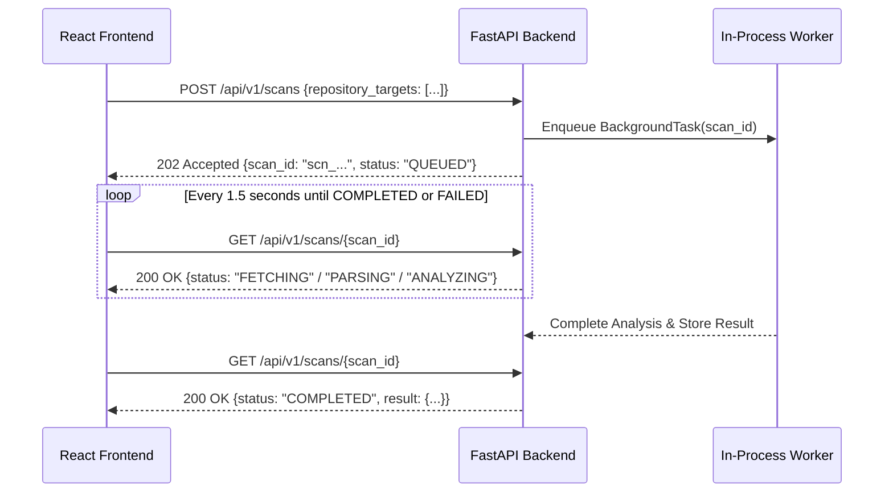

# DriftLock — API Contract Specification

This document defines the stable REST/JSON contract for DriftLock. Both the FastAPI backend and React frontend must adhere to this contract.

- **Base URL**: `http://localhost:8000`
- **Specification Format**: RESTful JSON (OpenAPI 3.1 compliant)
- **Content-Type**: `application/json`

---

## 1. Global Endpoints

### 1.1 Health & Upstream Capabilities Check
- **Path**: `GET /health` (also aliased at `/api/v1/health`)
- **Description**: Returns server liveness, version, and external service configuration state (GitHub, Gemini, SQLite cache).

#### Response: `200 OK`
```json
{
  "status": "healthy",
  "version": "0.1.0",
  "environment": "development",
  "timestamp": "2026-10-13T12:00:00.000Z",
  "services": {
    "github_api": {
      "authenticated": true,
      "rate_limit_remaining": 4980
    },
    "gemini_api": {
      "configured": true,
      "model": "gemini-1.5-flash"
    },
    "cache": {
      "type": "sqlite",
      "path": "driftlock_cache.db"
    }
  },
  "supported_manifests": [
    "package.json (Node.js declared)",
    "package-lock.json (Node.js resolved)",
    "requirements.txt (Python declared)",
    "pyproject.toml (Python declared)",
    "poetry.lock (Python resolved)"
  ]
}
```

---

## 2. Scan Lifecycle Endpoints

### 2.1 Initiate Cross-Repository Scan
- **Path**: `POST /api/v1/scans`
- **Description**: Enqueues an analysis job across up to three repository targets.
- **Query Parameters**:
  - `wait` (boolean, optional, default `false`): If `true`, the server holds the connection and responds synchronously upon completion (ideal for automated test suites or local CLI usage).

#### Request Body:
```json
{
  "repository_targets": [
    {
      "type": "github",
      "url": "https://github.com/my-org/user-service",
      "ref": "main"
    },
    {
      "type": "github",
      "url": "https://github.com/my-org/billing-service",
      "ref": "main"
    },
    {
      "type": "github",
      "url": "https://github.com/my-org/notification-service",
      "ref": "master"
    }
  ],
  "options": {
    "check_changelogs": true,
    "ecosystems": ["npm", "python"]
  }
}
```

#### Response: `202 Accepted` (when `wait=false`, Default Async Mode)
```json
{
  "scan_id": "scn_a1b2c3d4e5f6",
  "status": "QUEUED",
  "created_at": "2026-10-13T12:01:00.000Z",
  "poll_url": "/api/v1/scans/scn_a1b2c3d4e5f6",
  "message": "Scan job initiated. Poll the poll_url for progress updates."
}
```

#### Response: `200 OK` (when `wait=true`, Synchronous Mode)
Returns the complete `ScanRecord` payload identical to the final output of `GET /api/v1/scans/{scan_id}` below.

---

### 2.2 Get Scan Status & Results
- **Path**: `GET /api/v1/scans/{scan_id}`
- **Description**: Polls the execution progress or fetches the final completed analysis for a given `scan_id`.

#### Response: `200 OK` (In Progress)
```json
{
  "scan_id": "scn_a1b2c3d4e5f6",
  "status": "ANALYZING",
  "created_at": "2026-10-13T12:01:00.000Z",
  "updated_at": "2026-10-13T12:01:05.000Z",
  "progress": {
    "stage": "ANALYZING",
    "percentage": 75,
    "current_action": "Evaluating SemVer disparity and building NetworkX graph"
  },
  "result": null
}
```

#### Response: `200 OK` (Completed Scan)
```json
{
  "scan_id": "scn_a1b2c3d4e5f6",
  "status": "COMPLETED",
  "created_at": "2026-10-13T12:01:00.000Z",
  "completed_at": "2026-10-13T12:01:12.000Z",
  "duration_seconds": 12.4,
  "result": {
    "scanned_repositories": [
      {
        "name": "user-service",
        "url": "https://github.com/my-org/user-service",
        "manifest_count": 2,
        "total_dependencies": 24
      },
      {
        "name": "billing-service",
        "url": "https://github.com/my-org/billing-service",
        "manifest_count": 1,
        "total_dependencies": 18
      },
      {
        "name": "notification-service",
        "url": "https://github.com/my-org/notification-service",
        "manifest_count": 2,
        "total_dependencies": 19
      }
    ],
    "summary": {
      "total_unique_dependencies": 42,
      "shared_dependencies_count": 14,
      "drift_count": 5,
      "in_sync_count": 9,
      "severity_counts": {
        "MAJOR_DRIFT": 2,
        "MINOR_DRIFT": 3,
        "INFO": 28,
        "IN_SYNC": 9
      },
      "compatibility_risk_counts": {
        "CONFIRMED_BREAKING": 1,
        "SUSPECTED_BREAKING": 1,
        "NONE": 38,
        "UNKNOWN_IMPACT": 2
      }
    },
    "drift_matrix": [
      {
        "dependency_name": "react",
        "ecosystem": "npm",
        "drift_disparity": "MAJOR_DRIFT",
        "compatibility_risk": "CONFIRMED_BREAKING",
        "declarations_by_repo": {
          "user-service": {
            "declared_range": "^18.2.0",
            "resolved_version": "18.2.0",
            "dep_type": "runtime",
            "source_file": "package.json"
          },
          "billing-service": {
            "declared_range": "^17.0.2",
            "resolved_version": "17.0.2",
            "dep_type": "runtime",
            "source_file": "package.json"
          }
        },
        "present_in_repos": ["user-service", "billing-service"],
        "missing_in_repos": ["notification-service"],
        "recommended_version": "^18.2.0",
        "evidence": {
          "source_url": "https://github.com/facebook/react/releases/tag/v18.0.0",
          "cited_excerpt": "Automatic batching is enabled by default. ReactDOM.render has been replaced by createRoot.",
          "verified_breaking": true,
          "notes": "Verified via React official v18.0.0 release notes."
        }
      },
      {
        "dependency_name": "fastapi",
        "ecosystem": "python",
        "drift_disparity": "MINOR_DRIFT",
        "compatibility_risk": "NONE",
        "declarations_by_repo": {
          "user-service": {
            "declared_range": ">=0.100.0",
            "resolved_version": "0.110.0",
            "dep_type": "runtime",
            "source_file": "requirements.txt"
          },
          "notification-service": {
            "declared_range": ">=0.95.0",
            "resolved_version": "0.104.1",
            "dep_type": "runtime",
            "source_file": "requirements.txt"
          }
        },
        "present_in_repos": ["user-service", "notification-service"],
        "missing_in_repos": ["billing-service"],
        "recommended_version": ">=0.110.0",
        "evidence": {
          "source_url": "https://pypi.org/pypi/fastapi/json",
          "cited_excerpt": "Minor backward-compatible feature additions and performance improvements.",
          "verified_breaking": false,
          "notes": "No breaking changes reported between 0.104.1 and 0.110.0."
        }
      }
    ],
    "graph_summary": {
      "total_nodes": 45,
      "total_edges": 61,
      "density": 0.031,
      "highest_drift_nodes": ["react", "pydantic", "fastapi"]
    },
    "warnings": []
  }
}
```

---

## 3. Standard Error Responses

Errors follow standardized JSON formats with an HTTP status code, machine-readable `error_code`, human-readable `message`, and optional diagnostics.

### 3.1 400 Bad Request (Validation or Target Limit Exceeded)
```json
{
  "error_code": "INVALID_TARGETS",
  "message": "A scan must contain between 1 and 3 repository targets.",
  "details": {
    "provided_targets_count": 4,
    "max_allowed": 3
  }
}
```

### 3.2 404 Not Found
```json
{
  "error_code": "SCAN_NOT_FOUND",
  "message": "Scan with id 'scn_missing123' does not exist or has expired.",
  "details": {
    "scan_id": "scn_missing123"
  }
}
```

### 3.3 429 Too Many Requests (GitHub Rate Limit Exhausted)
```json
{
  "error_code": "RATE_LIMIT_EXCEEDED",
  "message": "GitHub API unauthenticated rate limit reached. Set GITHUB_TOKEN on backend or retry later.",
  "details": {
    "retry_after_seconds": 1800,
    "fallback_available": true
  }
}
```

### 3.4 500 Internal Processing Error
```json
{
  "error_code": "SCAN_FAILED",
  "message": "Unexpected failure during dependency graph generation.",
  "details": {
    "stage": "ANALYZING",
    "scan_id": "scn_a1b2c3d4e5f6"
  }
}
```

---

## 4. Frontend Polling Lifecycle Specification


