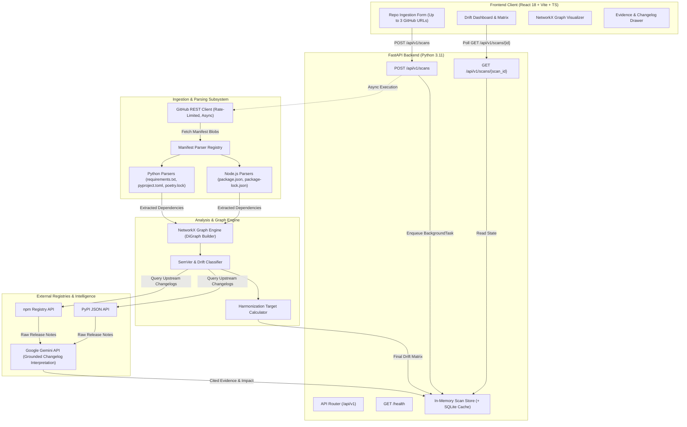

# DriftLock — System Architecture

## 1. High-Level Architecture Diagram

---

## 2. Subsystem Responsibilities

### 2.1 Ingestion & Routing Layer
- **Modules**: `app/api/v1/endpoints/scans.py`, `app/api/v1/endpoints/health.py`, `app/main.py`.
- **Function**:
  - Validates request payloads using Pydantic v2.
  - Generates unique scan identifier (`scn_<random_hex>`).
  - Schedules an asynchronous in-process scan worker via FastAPI `BackgroundTasks`.
  - Exposes health status, rate-limit consumption counters, and system capabilities.

### 2.2 Manifest & Lockfile Parsing Subsystem
- **Modules**: `app/parsers/package_json.py`, `app/parsers/package_lock.py`, `app/parsers/requirements_txt.py`, `app/parsers/pyproject_toml.py`, `app/parsers/poetry_lock.py`.
- **Function**:
  - **Crucial Separation**:
    - **Declared Parser**: Extracts dependency ranges (`^18.2.0`, `>=0.110.0,<1.0.0`) and categories (`runtime`, `dev`, `peer`).
    - **Lockfile Parser**: Extracts concrete resolved pins (`18.2.0`, `0.110.1`).
  - Normalizes package names (lowercase canonicalization per PEP 503 for Python; standard npm casing).
  - Isolates malformed file errors without aborting other repository scans.

### 2.3 NetworkX Cross-Repository Graph Engine
- **Modules**: `app/services/graph_service.py`.
- **Function**:
  - Instantiates a `networkx.DiGraph`.
  - Node Types:
    - `RepositoryNode`: Attributes `name`, `url`, `commit_sha`.
    - `PackageNode`: Attributes `name`, `ecosystem`, `is_shared`.
  - Edge Types:
    - Directed edge from `RepositoryNode` to `PackageNode` with edge data:
      `{ declared_range: str, resolved_version: str | None, dep_type: str, file_origin: str }`.
  - Graph Operations:
    - Extracts shared dependency subgraphs (`degree(PackageNode) > 1`).
    - Computes clustering metrics and centrality (identifying high-impact shared foundational packages).

### 2.4 Version & Drift Classification Engine
- **Modules**: `app/services/version_service.py`.
- **Function**:
  - Compares version pairs using `packaging.version.Version` (Python) and SemVer rules (npm).
  - Evaluates:
    - **Declared Drift**: Do manifest constraints allow overlapping runtime versions?
    - **Resolved Drift**: Do lockfile versions diverge?
  - Assigns `DriftDisparity`:
    - `IN_SYNC`: Identical constraints and identical locked versions.
    - `MINOR_DRIFT`: Divergence within the same major version.
    - `MAJOR_DRIFT`: Divergence across major version boundaries.
    - `INFO`: Package unique to a single repository.

### 2.5 Evidence-Grounded Changelog & Gemini Intelligence Engine
- **Modules**: `app/services/registry_client.py`, `app/services/gemini_service.py`.
- **Function**:
  - Queries PyPI / npm for release history between divergent versions.
  - Extracts official release notes or GitHub release bodies.
  - **Grounding Mandate**: Feeds raw release notes to Google Gemini API (`gemini-1.5-flash`) with a system prompt requiring explicit quotes.
  - If no changelog is located, sets `compatibility_risk = UNKNOWN_IMPACT` with `evidence_text = ""` — **zero synthetic hallucinations allowed**.

### 2.6 State Storage & Optional SQLite Cache
- **Modules**: `app/services/scan_store.py`, `app/core/database.py`.
- **Function**:
  - **In-Memory Store**: Holds active scan objects (`ScanRecord`) with timestamps and TTL.
  - **SQLite Cache** (`driftlock_cache.db`):
    - Table `http_cache`: Cached GitHub tree responses and registry metadata (keyed by SHA / ETag).
    - Table `changelog_cache`: Cached Gemini interpretations for package version pairs `(pkg, from_ver, to_ver)` to eliminate redundant API cost.

---

## 3. Data Flow Walkthrough

1. **Submission**: User inputs up to 3 GitHub repository URLs into the React UI. The client issues `POST /api/v1/scans`.
2. **Registration**: Backend creates `scan_id`, marks status as `QUEUED`, stores in `ScanStore`, and triggers background task. Backend immediately returns `202 Accepted` with `scan_id`.
3. **Fetching**: Background task contacts GitHub REST API, checks rate limit budget, retrieves repository file trees, and fetches manifest contents (`package.json`, `package-lock.json`, `requirements.txt`, etc.). Status transitions to `FETCHING`.
4. **Parsing**: Manifests are dispatched to registered parsers. Declared ranges and resolved versions are recorded. Status transitions to `PARSING`.
5. **Graph Construction & Analysis**: Parsed dependencies are inserted into a NetworkX `DiGraph`. Drift classifier identifies divergent packages. Status transitions to `ANALYZING`.
6. **Intelligence Gathering**: Divergent packages query npm/PyPI for release notes; Gemini parses breaking changes with verbatim citations.
7. **Completion**: Final `ScanRecord` is updated to `COMPLETED` with full drift matrix, graph summary, and evidence records. Polling UI receives full payload.

---

## 4. Fault Containment & Graceful Degradation

| Failure Mode | Subsystem Affected | Fallback Behavior |
|---|---|---|
| **GitHub Rate Limit Exhausted** | Ingestion | Returns HTTP 429 in scan status with `retry_after_seconds`. Fallback mode loads mock fixture repositories for demonstration. |
| **Malformed Manifest File** | Parser | Parser logs warning in `skipped_items` array; scan continues with remaining valid files. |
| **Missing Lockfile** | Parser | Operates in *Declared-Only Mode*; resolved versions marked as `None` without failure. |
| **PyPI / npm Timeout** | Upstream Client | Skips changelog retrieval for affected package; assigns `compatibility_risk: UNKNOWN_IMPACT`. |
| **Gemini API Error or Quota Exceeded** | Intelligence | Heuristic fallback: assigns `SUSPECTED_BREAKING` for major SemVer jumps with note *"Gemini unavailable; heuristic classification"*. |
