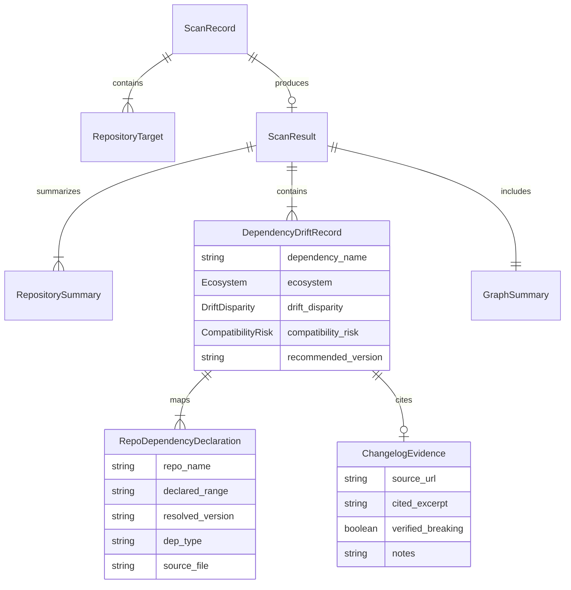

# DriftLock — Data Model & Schema Specification

This document details the complete domain data model, Pydantic v2 schemas, and entity relationships governing DriftLock.

---

## 1. Entity-Relationship Overview



---

## 2. Core Enumerations

```python
from enum import Enum

class Ecosystem(str, Enum):
    NPM = "npm"
    PYTHON = "python"

class DependencyType(str, Enum):
    RUNTIME = "runtime"
    DEV = "dev"
    PEER = "peer"
    OPTIONAL = "optional"

class ScanStatus(str, Enum):
    QUEUED = "QUEUED"
    FETCHING = "FETCHING"
    PARSING = "PARSING"
    ANALYZING = "ANALYZING"
    COMPLETED = "COMPLETED"
    FAILED = "FAILED"

class DriftDisparity(str, Enum):
    """Measures purely semantic/syntactic version difference."""
    IN_SYNC = "IN_SYNC"          # All declared ranges and resolved versions match
    MINOR_DRIFT = "MINOR_DRIFT"  # SemVer minor or patch disparity (backward-compatible range)
    MAJOR_DRIFT = "MAJOR_DRIFT"  # SemVer major disparity (breaking boundary crossed)
    INFO = "INFO"                # Dependency declared in only one repository

class CompatibilityRisk(str, Enum):
    """Measures verified or suspected functional risk to the system."""
    NONE = "NONE"                          # Same version or proven compatible bump
    SUSPECTED_BREAKING = "SUSPECTED_BREAKING" # Major version jump lacking explicit changelog text
    CONFIRMED_BREAKING = "CONFIRMED_BREAKING" # Grounded evidence extracted proving breaking changes
    UNKNOWN_IMPACT = "UNKNOWN_IMPACT"      # Release notes unavailable or inconclusive
```

---

## 3. Strict Boundary Distinctions

### Boundary 1: Declared Specification vs. Resolved Version
Developer manifests express **intent and bounds**, while lockfiles represent **concrete deterministic reality**:

| Attribute | Declared Specification | Resolved Version |
|---|---|---|
| **Source File** | `package.json`, `requirements.txt`, `pyproject.toml` | `package-lock.json`, `poetry.lock` |
| **Format Example** | `^18.2.0`, `>=0.110.0,<1.0.0`, `~2.1` | `18.2.0`, `0.110.1` |
| **Field in Model** | `declared_range` (`str`) | `resolved_version` (`Optional[str]`) |
| **Analysis Usage** | Detects developer contract conflict | Detects actual runtime divergence |

### Boundary 2: Version Drift Disparity vs. Compatibility Impact
A major version jump does not automatically mean code breaks, and minor bumps can occasionally introduce regressions. We separate these two concerns:
1. `drift_disparity` represents mathematical SemVer difference (`MAJOR_DRIFT`, `MINOR_DRIFT`).
2. `compatibility_risk` represents actual grounded evaluation (`CONFIRMED_BREAKING`, `NONE`, `UNKNOWN_IMPACT`) backed by `ChangelogEvidence`.

---

## 4. Pydantic v2 Models

```python
from datetime import datetime
from typing import Dict, List, Optional
from pydantic import BaseModel, Field, HttpUrl

# -------------------------------------------------------------
# Input Target Models
# -------------------------------------------------------------

class RepositoryTarget(BaseModel):
    type: str = Field(default="github", description="'github' or 'upload'")
    url: Optional[str] = Field(default=None, description="GitHub repository HTTPS URL")
    ref: str = Field(default="main", description="Git branch, tag, or commit SHA")
    name: Optional[str] = Field(default=None, description="Derived repository name")

class ScanOptions(BaseModel):
    check_changelogs: bool = Field(default=True, description="Query npm/PyPI and Gemini for changelog analysis")
    ecosystems: List[Ecosystem] = Field(default_factory=lambda: [Ecosystem.NPM, Ecosystem.PYTHON])

class ScanCreateRequest(BaseModel):
    repository_targets: List[RepositoryTarget] = Field(
        ...,
        min_length=1,
        max_length=3,
        description="List of 1 to 3 repository targets to scan"
    )
    options: ScanOptions = Field(default_factory=ScanOptions)

# -------------------------------------------------------------
# Dependency & Evidence Models
# -------------------------------------------------------------

class RepoDependencyDeclaration(BaseModel):
    declared_range: str = Field(..., description="Manifest constraint (e.g., '^18.2.0')")
    resolved_version: Optional[str] = Field(default=None, description="Locked version (e.g., '18.2.0')")
    dep_type: DependencyType = Field(default=DependencyType.RUNTIME)
    source_file: str = Field(..., description="Origin file path (e.g., 'package.json')")

class ChangelogEvidence(BaseModel):
    source_url: Optional[str] = Field(default=None, description="URL of official release notes")
    cited_excerpt: str = Field(default="", description="Verbatim quote from changelog stating breaking change or upgrade note")
    verified_breaking: bool = Field(default=False, description="True if cited excerpt confirms breaking API changes")
    notes: str = Field(default="", description="Grounded LLM interpretation rationale")

class DependencyDriftRecord(BaseModel):
    dependency_name: str = Field(..., description="Normalized package name")
    ecosystem: Ecosystem = Field(...)
    drift_disparity: DriftDisparity = Field(...)
    compatibility_risk: CompatibilityRisk = Field(...)
    declarations_by_repo: Dict[str, RepoDependencyDeclaration] = Field(
        ...,
        description="Keyed by repository name"
    )
    present_in_repos: List[str] = Field(default_factory=list)
    missing_in_repos: List[str] = Field(default_factory=list)
    recommended_version: Optional[str] = Field(default=None, description="Suggested target unified version")
    evidence: Optional[ChangelogEvidence] = Field(default=None)

# -------------------------------------------------------------
# Graph & Summary Models
# -------------------------------------------------------------

class GraphSummary(BaseModel):
    total_nodes: int
    total_edges: int
    density: float
    highest_drift_nodes: List[str]

class RepositorySummary(BaseModel):
    name: str
    url: Optional[str]
    manifest_count: int
    total_dependencies: int

class ScanMetricsSummary(BaseModel):
    total_unique_dependencies: int
    shared_dependencies_count: int
    drift_count: int
    in_sync_count: int
    severity_counts: Dict[str, int]
    compatibility_risk_counts: Dict[str, int]

class ScanResult(BaseModel):
    scanned_repositories: List[RepositorySummary]
    summary: ScanMetricsSummary
    drift_matrix: List[DependencyDriftRecord]
    graph_summary: GraphSummary
    warnings: List[str] = Field(default_factory=list)

# -------------------------------------------------------------
# Scan Job Record
# -------------------------------------------------------------

class ScanProgress(BaseModel):
    stage: ScanStatus
    percentage: int
    current_action: str

class ScanRecord(BaseModel):
    scan_id: str
    status: ScanStatus
    created_at: datetime
    updated_at: datetime
    completed_at: Optional[datetime] = None
    duration_seconds: Optional[float] = None
    progress: Optional[ScanProgress] = None
    result: Optional[ScanResult] = None
    error: Optional[Dict[str, str]] = None
```
