# DriftLock — 24-Hour Development Plan & Team Allocation

This document sets the hour-by-hour execution schedule for the 4-engineer team to deliver the DriftLock MVP by hour 18–20.

---

## 1. Schedule Breakdown (24-Hour Hackathon)

```mermaid
gantt
    title DriftLock 24-Hour Roadmap
    dateFormat X
    axisFormat %Hh

    section Phase 0: Contract
    Foundation & Specs (Docs & Schemas)       :done, p0, 0, 4

    section Phase 1: Core Engine
    Parsers (package-lock, poetry.lock)       :active, p1_e2, 4, 8
    NetworkX Graph Construction               :p1_e2_g, 6, 9
    In-Process Background Worker Engine       :p1_e1, 4, 8

    section Phase 2: Ingestion & Registries
    GitHub REST API Client & Rate-Limiting    :p2_e1, 8, 12
    npm & PyPI Registry Fetcher               :p2_e3, 8, 12
    Frontend UI Scaffolding & State Store     :p2_e4, 4, 11

    section Phase 3: Intelligence & UI
    Gemini Grounded Changelog Interpreter    :p3_e3, 12, 16
    Frontend Drift Matrix & Graph Visualizer  :p3_e4, 11, 16
    Harmonization Solver                      :p3_e2, 12, 15

    section Phase 4: Integration (Target MVP)
    End-to-End System Integration             :p4_all, 16, 19
    Automated Test Suite & Edge Cases         :p4_t, 18, 20

    section Phase 5: Polish & Demo
    UI Transitions & Demo Dataset Setup       :p5_demo, 20, 22
    Presentation Video & Final Dry Run        :p5_final, 22, 24
```

---

## 2. Workstream Breakdown by Engineer

### Engineer 1: Backend Lead (Core Service & Ingestion)
- **Hours 0–4**: Review contract; finalize FastAPI routes `POST /api/v1/scans`, `GET /api/v1/scans/{scan_id}`, `GET /health`.
- **Hours 4–8**: Implement `app/services/scan_store.py` (in-memory job tracker with thread lock) and FastAPI `BackgroundTasks` lifecycle.
- **Hours 8–12**: Implement `app/services/github_fetcher.py` with unauthenticated/authenticated token support, tree traversal, rate-limit header parsing, and exponential retry.
- **Hours 12–16**: Add SQLite caching for tree blobs; integrate rate-limit 429 graceful fallback to mock fixtures.
- **Hours 16–20**: Lead end-to-end integration and API performance profiling.
- **Hours 20–24**: Deploy backend / ensure local zero-lag execution; rehearse demo pitch.

### Engineer 2: Graph & Analysis Lead
- **Hours 0–4**: Align on `DependencyDriftRecord` schema and SemVer rules.
- **Hours 4–8**: Extend parsers to extract lockfile resolved versions (`package-lock.json`, `poetry.lock`).
- **Hours 8–12**: Implement `app/services/graph_service.py` using NetworkX (`DiGraph` creation, node/edge labeling, subgraph filtering for shared packages).
- **Hours 12–16**: Implement harmonization target solver (determining the optimal recommended version across N services).
- **Hours 16–20**: Write property-based and unit tests for version comparison and graph edge consistency.
- **Hours 20–24**: Support frontend graph visualizer formatting (D3/ReactFlow node serialization).

### Engineer 3: Intelligence & Registry Lead
- **Hours 0–4**: Formulate strict anti-hallucination prompt and citation schema for Gemini API.
- **Hours 4–8**: Build mock changelog fixtures for test runs (`react@17` -> `18`, `fastapi@0.100` -> `0.110`, `pydantic@1.10` -> `2.6`).
- **Hours 8–12**: Build `app/services/registry_client.py` for PyPI and npm to fetch release metadata and release note excerpts.
- **Hours 12–16**: Implement `app/services/gemini_service.py` to prompt Gemini, enforce verbatim quotes in `cited_excerpt`, and classify `compatibility_risk`.
- **Hours 16–20**: Add SQLite changelog cache to eliminate repetitive LLM queries for the same version pairs.
- **Hours 20–24**: Curate compelling real-world demo repositories showcasing breaking changes.

### Engineer 4: Frontend Lead (React + Vite + TS)
- **Hours 0–4**: Review `docs/API_CONTRACT.md` and seed client mock types matching Pydantic models.
- **Hours 4–8**: Scaffold Vite React app, Tailwind CSS tokens, and layout shell (Navigation, Header, Repo Input Form).
- **Hours 8–12**: Build Ingestion Form supporting up to 3 GitHub URLs, polling state hook (`useScanJob`), and loading skeleton screens.
- **Hours 12–16**: Build Drift Matrix table with badge filtering (`CRITICAL`, `WARNING`, `IN_SYNC`) and interactive Changelog Evidence Drawer.
- **Hours 16–20**: Wire in dependency graph visualizer (using lightweight SVG or visual nodes) and end-to-end API connection.
- **Hours 20–24**: UI polish, micro-animations, copy review, and demo recording assistance.

---

## 3. Milestones & Checkpoints

| Checkpoint | Target Time | Criteria |
|---|---|---|
| **Checkpoint 1** | Hour 4 | Phase 0 complete: all docs signed off, contracts frozen, mock payloads distributed. |
| **Checkpoint 2** | Hour 8 | Standalone parsers handle both declared manifests and resolved lockfiles with unit tests passing. |
| **Checkpoint 3** | Hour 12 | Background task completes GitHub tree fetch -> parse -> NetworkX graph construction. |
| **Checkpoint 4** | Hour 16 | Frontend polls real backend; Gemini changelog evidence displays cited quotes. |
| **Checkpoint 5 (MVP Delivery)** | Hour 19 | Full end-to-end scan on 3 live public repos works seamlessly with zero manual intervention. |
| **Checkpoint 6 (Rehearsal)** | Hour 22 | Complete demo pitch rehearsed twice; backup screen-recording secured. |
